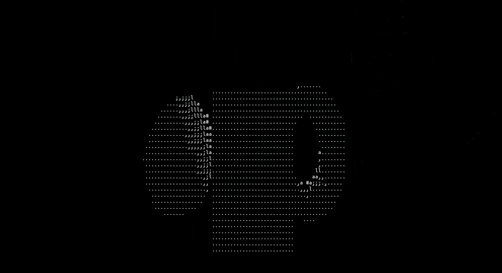

# Rust 3d Engine

This is a simple project to practice 3d algorithms and practice Rust inspired by the youtube channel: [Quantale](https://www.youtube.com/watch?v=UkPTyojw7IA).

<center>


<p>Demo</p>
</center>

## Getting started

### Prerequisites

Rust environment installed.

```shell
$ rustup check
```

### Installation

```shell
$ cargo build
```

### Run

Without build

```shell
$ cargo run
```

With the build

```shell
$ .\target\debug\engine_3d.exe
```

## Controls

### Camera Movement
- **Arrow Up** - Look up
- **Arrow Down** - Look down
- **Arrow Left** - Turn left
- **Arrow Right** - Turn right
- **Z** - Move forward
- **S** - Move backward
- **Q** - Strafe left
- **D** - Strafe right
- **Space** - Move up
- **Ctrl + Space** - Move down

### Object Manipulation
- **R** - Rotate objects counterclockwise
- **Shift + R** - Rotate objects clockwise

### Lighting
- **T** - Toggle light source circular motion

### Application
- **Ctrl + C** - Exit the application

## Licencing

Distributed under the MIT License. See `LICENSE.txt` for more information.
